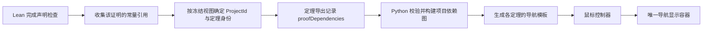

**定理依赖导出与鼠标导航重构方案**

状态：全部六个阶段已完成，包括真实示例的完整导出、浏览器交互、缓存渲染、原子发布及迁移清理验收。完整 bundle 协议为 `4.0.0`，命名 proof artifact 已写出必需的 `proofDependencies`，导航使用这些事实构图，当前定理由鼠标命中决定。

已确认的需求：项目边界按 `ProjectId` 判断。当前代码中该 ID 是非空字符串（`String`），点号与 Unicode 原样保留，不是 Lean `Name`。鼠标位于某个定理正文时选择该定理，进入它对应的导航时继续保留，进入其他定理时切换。离开正文和对应导航后隐藏。

**总体设计**

将功能分成三个独立部分：Lean 产生逐定理的证明事实；Python 在渲染前建立项目依赖图；浏览器只根据鼠标命中区域选择已经生成的导航。



`theorem_info` 继续管理标题、项目、标签等可编辑配置。新增依赖字段属于只读的导出事实，不允许通过 `theorem_info`、`extra` 或渲染规则手工覆盖。

现有 `RenderDependency` 表示冻结渲染配置所需的数据；现有 `getTheoremRefs` 表示可选的文献引用收集。这两者均不作为证明依赖图的数据源。

**依赖的精确定义**

固定字段为 `proofDependencies`，表示该声明最终证明项引用的、与它属于同一 `ProjectId` 的所有直接定理依赖。

- 收集最终提交的证明项，不扫描源码、注释、整个表达式导出表或失败的 tactic 尝试。
- `T` 的证明直接使用 `U`，就记录 `T → U`。若 `U` 又使用 `V`，传递关系由图推导，不把它混入 `T` 的直接依赖。
- 普通 Lean `theorem`，以及明确登记为 `@theorem`、`@lemma` 的声明，均可成为依赖目标。
- 普通 Lean 定理需要有明确的项目归属，才能判断是否属于当前项目；未归属任何项目的声明不会因为命名空间相同而自动纳入。
- `@lemma` 使用同一套采集与导出机制。它可以是依赖目标，也拥有与正文一致的鼠标导航，不再出现“选择器选中 lemma、渲染器却没有面板”的不对称行为。
- 自引用排除，重复引用去重，导出结果按 Lean `Name.lt`（`Name.cmp`）排序，不按打印名或哈希排序。读取时拒绝重复与自引用，不静默修复。
- 收集不受 `referenceCollection`、`@references`、录制开关或展示策略影响。

这里的“完整”是所有已导出定理之间的完整关系，以及它们指向其他项目内定理的关系；不声称知道未加载模块中尚未导出的证明如何使用这些定理。

**声明身份与项目归属**

声明身份使用 Lean 的真实 `Name`，JSON 复用 `Foundation` 的无损名称编码和 `qualifiedNameSchema`。Python 使用现有 `name_key` 转换成内部键，不能用短名、文件名、标题或字符串分割重新识别声明。

语义图以 `(ProjectId, declaration)` 为键。DOM 的逻辑定理标识由这组身份确定，正文的中英文实例共享逻辑标识；各实例的 HTML `id` 仍然唯一。现有已修复的页面锚点保持稳定，浏览器不再通过裁掉 `-en` 来反推定理身份。

统一的项目解析接口已实现为 `resolveTheoremProject(env, query, declaration, defaultProject)`，以及要求源定理必须归属项目的 `requireTheoremProject`：

1. `@theorem` / `@lemma` 成功建立时登记声明种类、定义模块和当时的活动项目，作为默认归属。
2. 在该声明所属页面的冻结边界解析 `theorem_info` 的项目赋值；显式赋值优先，包括显式 `none`，不能把它误当成“未设置”。
3. 没有项目赋值时使用登记的默认归属。项目归属与依赖集合一起冻结，导出器不能改用自己当前的活动项目重新解释。
4. 启用此项目依赖导出时，源定理无法解析出 `ProjectId` 应给出明确诊断；不能把所有 `none` 当成同一个项目，也不能将无法采集伪装成空依赖。

解析只读取项目字段的候选赋值，不把 schema 的默认 `null` 当成显式赋值；`none` 与 `reset` 都明确取消归属。返回的非空项目必须在同一视图中已配置，字段冲突和无效项目均报错。

第二阶段已在成功建立 `@theorem` / `@lemma` 时初始化项目元数据。后来只改标题的 `theorem_info` 不再以它执行时的活动项目覆盖默认归属；普通 Lean theorem 仍使用首次元数据命令的现有初始化规则，或者显式指定项目。

对被引用声明使用同一冻结视图中的明确项目归属。跨项目的同名定理不会进入集合。若同一导出身份出现不一致的事实记录，应报告冲突而非覆盖其中一个。

**Lean 端采集与冻结**

逐声明事实模型位于 `Info/Declaration.lean`：

```text
DeclarationFacts
  declaration     : Name
  ownerModule     : Name
  sequence        : Nat
  declarationKind : theorem | lemma
  defaultProject  : Option String
  proofConstants  : Array Name
```

这份原始记录通过持久化环境扩展保留，以便导入 `.olean` 后仍能识别 ProofScript 声明。记录必须来自成功的声明事务，失败或回滚不得遗留条目。

`:= script` 和 `:= by` 共用一个完成入口：取得已完成声明的证明值，再用 `Expr.getUsedConstants` 收集常量。不能只检查 `ConstantInfo.thmInfo`：目前 `@theorem` 的实现声明是 `opaque`。因此需要显式的声明种类登记，并以 `ConstantInfo.value? (allowOpaque := true)` 读取完整证明。读取根声明时先等待其异步 elaboration 完成，再检查所引用的常量与辅助声明。

普通 Lean theorem 可以通过其声明种类识别，项目仍由统一项目解析接口决定。ProofScript 自动生成的检查声明应有明确的内部身份，不能成为面向用户的依赖节点。

第一阶段已验证编译器辅助声明的两个来源：本次声明事务新增的常量，以及 Lean `Meta.auxLemmasExt` 记录的缓存辅助证明。后者可能复用前一个命令生成的常量，因此只取本次新增集合会漏依赖。

第二阶段已按如下规则归一化原始证明引用：

1. 只从最终证明项的常量引用开始遍历。
2. 普通 Lean theorem 和已登记的用户 `@theorem` / `@lemma` 是依赖边界：记录名字，停止展开其证明。
3. 对本次事务产生的辅助声明、已登记的辅助声明、Lean 辅助证明缓存中的声明做受控展开，并用访问集合避免重复和循环。
4. 内部检查声明登记其真实名称及对应用户声明；被引用时映射回用户声明，不成为导航节点。不能靠 `scriptcheck_` 或 `_private` 前缀判断身份。
5. 持久化展开辅助层后的常量引用，再在冻结边界按项目过滤。Lean 的辅助证明缓存本身不写入 `.olean`，生产实现不能指望导入时重新取得这份缓存；需要的辅助来源/映射应随事实登记保存。

测试探针为验证来源而枚举本地常量差集。生产实现仅遍历可达引用，用前后环境的 `contains` 查询判断是否新增，并缓存辅助展开结果，不扫描整个模块的常量表。展开不了必要辅助证明时会报错，不伪装成空集合，也不递归展开任意已有定义或用户定理。

在 `page_end` 的同一冻结事务中：

1. 取得该页面待冻结定理的原始事实。
2. 使用明确的 `Query` 解析项目归属并过滤证明常量。
3. 生成最终 `proofDependencies`，与定理的配置快照建立对应关系。
4. 校验全部结果后再提交状态和写出文件。

没有 `page_end` 的独立证明使用现有模块末尾冻结边界，不能遗漏这类 `@theorem`。已冻结页面的结果不得在导出其他模块时被重新计算。

第二阶段的实际事务边界如下：

- 主 opaque、普通 theorem 检查、声明事实、项目初始化、录制 artifact 和页面组件由同一个 `elaborateDeclaration` 事务完成。两种证明共用 `completeDeclaration`。检查命令在事务内同步完成；证明失败、检查名冲突或后处理抛错会恢复环境状态，证明文件在最后写出。
- `page_end` 先计算配置快照，再将同一查询边界的 `FrozenTheoremFacts` 写入持久化扩展；其中固定保存 `ownerModule`、`query`、`snapshotId` 与 `TheoremExport`。全部校验完成后才关闭页面和写出页面文件。
- `freezeModuleArtifacts` 同时校验语义事实；新接口 `freezeModuleTheorems` 返回 artifact ID 与冻结事实的对应关系。对已关闭页面读取持久化结果，对独立证明及 `page_end` 后的证明使用定义模块的 `.endOfModule` 视图。模块末尾结果由纯接口返回，不向导出器当前环境写入伪造的定义模块事件。
- 导出阶段需要项目归属：无活动项目时仍可声明定理，随后用 `theorem_info` 指定归属；若到 `page_end` 或独立证明导出时仍没有项目，则报错。现有导出测试已补齐显式项目。

**导出契约与存储位置**

建议在现有 proof artifact 对应的定理导出记录中新增固定字段，而不是只把字段放进页面组件。这样独立的 `@theorem`、没有页面的定理以及模块末尾冻结的定理都有统一记录。

概念上的定理导出模型为 `TheoremExport`，其固定信息来自 artifact、冻结配置与证明事实。以下是字段示意，其余现有 artifact 字段省略：

```json
{
  "declaration": ["DerivExprRule", "add"],
  "projectId": "Calculus_21",
  "proofDependencies": [
    ["FuncLimit", "add"],
    ["DerivExprRule", "smul"]
  ]
}
```

- `proofDependencies` 是必需字段；`[]` 只表示成功采集后没有项目内直接依赖。
- 三个固定字段的类型、JSON codec 与独立 schema 位于 `ProofScript/Output/Theorem.lean`。该模型是 proof artifact 的字段投影，不是另一份页面事实存储。第三阶段已统一升级写入器、schema 和读取器。
- 依赖名称与声明名称复用同一种无损名称协议。
- 页面通过 proof artifact 取得同一份事实，不再独立保存或计算第二套依赖。
- 同步更新协议/schema、Lean 序列化、Python bundle 校验，以及相关摘要和版本检查。
- 项目归属来自定理自身的冻结结果。`Output.Export` 对命名 proof artifact 使用统一解析结果；页面和未命名录制仍保留其视图的活动项目。
- 老缓存缺少该字段时应要求重新通过 Lean 导出，禁止回退到源码匹配，也禁止默认为空数组。
- 保留现有“完整 staging 校验后原子发布”的流程；Python 不在发布阶段改写 Lean 产生的证明事实。

页面投影还需同步调整：当前 `resolveSnapshotComponents` 会重建定理的 `value`，只保留 `name`、`proof`、`sorryAx`。不能在更早的位置临时塞入新字段后，期待它自动保留到最终页面。渲染器应通过显式 artifact 引用读取 `TheoremExport`，而不是依赖自由 JSON 字段的偶然透传。

**Python 端图模型**

独立模块 `PS4HTML/theorem_graph.py` 只消费已验证的定理导出记录，提供：

```text
TheoremGraph
  nodes        : (ProjectId, Name) → 定理记录或未导出目标
  uses         : (ProjectId, Name) → 直接依赖集合
  used_by      : (ProjectId, Name) → 使用它的导出定理集合
  destinations : (ProjectId, Name) → 可选的页面定位信息
  modules      : bundle 明确列出的模块集合
```

构图过程：

1. 装载本次 bundle 中所有定理记录，并按项目分组。
2. 校验身份、字段、重复记录与项目一致性。
3. 将 `proofDependencies` 原样转换为正向边，同时生成反向边。
4. 建立页面目标索引；找不到页面的项目内依赖保留为无链接节点，不生成坏链接。
5. 构图完成后，再选择当前需要写出的页面并生成导航模板。

建立正向边和反向边的基础工作量为 `O(V + E)`；显示排序单独计算。排序可使用页面顺序及稳定身份顺序，不能直接比较可能混有数字和字符串的名称分量。Python 若复现名称顺序，必须实现与 `Name.cmp` 相同的带类型比较，或使用无碰撞的稳定排序键。

构图范围必须与导出范围一致。若要求跨多个 Lean library 查看整个项目的下游定理，需要先让导出阶段汇集该项目相应模块的事实；渲染器不能从一个只包含部分模块的 bundle 推断出完整项目。

不扫描任意旧缓存来补齐缺失数据。图的覆盖范围由当前已验证 bundle 的 `modules` 清单及实际导出的 theorem proof artifacts 明确界定；先读齐这些记录，再筛选渲染页面。跨库汇总应由构建清单显式提供模块集合。已有 completion 标志表示该 bundle 已完整发布，不应被解释成“项目所有模块都已包含”。

`used_by` 默认展示直接使用当前定理的导出定理。传递上游/下游可以作为以后独立的图查询，不改变持久化字段的直接依赖语义。

第四阶段已删除 `build_theorem_dependency_index` 及其源码搜索、短名正则、表达式表扫描和静默吞掉读取失败的路径。部分页面输出仍使用全 bundle 图；未包含在本次输出中的页面目标保留为无链接文本，避免产生不存在的页面链接。

**导航视图**

Python 根据图生成每个定理的完整导航模板。页面使用一个可见导航容器，其他定理的导航保存在不可显示的 `<template>` 中。

- 正文通过 `data-theorem-id` 标记逻辑身份。
- 控制器只维护 `activeTheoremId`，视图负责装载对应模板或清空。
- 同一时刻只有一个模板实例进入显示容器，从结构上保证只有一个蓝色中心节点。
- 浏览器不计算证明依赖，不自行寻找下游，也不根据标题或锚点字符串识别定理。
- 切换中英文只更换正文实例，保留相同的逻辑定理身份。

此处不要求重新设计已有依赖图的视觉样式，也不需要改变已修复的页面锚点。

**鼠标选择与交互状态**

新增明确的鼠标控制器。命中判断使用当前鼠标的视口坐标，通过 `elementFromPoint` 查找可见正文中的最近定理容器，而非遍历定理并比较滚动高度。

```text
Hidden
  命中定理 T → Active(T)

Active(T)
  命中定理 U → Active(U)
  命中 T 的导航 → Active(T)
  离开正文和对应导航 → PendingClose(T)

PendingClose(T)
  回到 T 正文或导航 → Active(T)
  命中定理 U → Active(U)
  短暂移出期限到达 → Hidden
```

正文与左侧导航之间存在空隙，建议采用约 150ms 的关闭延迟，便于鼠标跨越空隙；进入另一条定理时立即切换，不等待延迟。离开浏览器窗口、窗口失焦或页面进入后台时立即清空，不无限保留上一条定理。

命中范围包含定理标题、证明正文、展开的分支以及源代码翻转面；一般说明文字、页面空白与其他侧栏区域不选择定理。鼠标位于导航链接上时保持当前源定理，不把链接指向的目标自动当成鼠标选中的定理。

事件处理建议：

- 使用 `pointermove` 取得鼠标坐标，并通过 `requestAnimationFrame` 合并一帧内的更新。
- 只响应具有鼠标悬停语义的输入；不把触摸事件伪装成持续悬停。
- 定理身份没变时不重建导航，避免在子元素间移动造成闪烁。
- 鼠标静止时，页面滚动仍可能改变光标下面的元素。因此保留滚动和布局变化通知，但其用途只是按保存的鼠标坐标重新命中，绝不恢复滚动阈值选择。
- 捕获滚动容器变化，并在 resize、语言切换、分支展开、源代码翻转和公式渲染导致布局变化后重新命中。
- 没有已知鼠标坐标时初始隐藏。URL hash 本身不指定当前定理。

语言与主要布局组件应发出明确的变化通知，必要时使用 `ResizeObserver` 补充；避免由导航自身的显示变化触发无限重算。

键盘固定选择、触摸点击固定等交互可以后续独立设计，本次不隐式改变已确认的鼠标选择标准。

**实施阶段与交付物**

| 阶段 | 主要任务 | 完成标准 |
|---|---|---|
| 1：契约与技术验证（已完成） | 实现 `TheoremExport`、项目解析接口与最小探针；明确图覆盖范围；验证 script/by 的 opaque 证明读取、辅助声明与缓存复用 | 新增契约和探针测试均通过；后续接入不依赖短名或辅助声明前缀 |
| 2：Lean 证明事实（已完成） | 持久化逐声明事实与内部身份；统一 script/by 成功与回滚入口；支持普通 theorem 和 `@lemma` 目标；在页面或模块边界冻结项目与依赖 | 生产采集与独立探针对照通过；失败回滚、跨模块导入、项目冲突及冻结视图回归通过 |
| 3：导出协议与读取（已完成） | 为定理记录增加必需字段；修正定理 artifact 项目归属；更新 schema、版本、摘要校验；在 `InfoBundle` 暴露统一定理记录接口 | 独立定理与页面定理都有字段；旧缓存明确拒绝；冻结数据不被导入方重新解释 |
| 4：项目图与渲染（已完成） | 实现独立图模块；先收集全部记录再筛选页面；建立反向关系与目标索引；删除猜测算法；输出单容器及模板 | 正反向边一致，未导出目标不丢失、不产生坏链接，页面渲染不再读取源码猜依赖 |
| 5：鼠标控制器（已完成） | 实现状态机、正文与导航共用交互、移出延迟、单容器更新、静止鼠标下的布局重新命中 | 同时最多一个当前节点；离开后隐藏；鼠标可以到导航点击；滚动高度不决定选择 |
| 6：集成与迁移（已完成） | 补齐跨模块和浏览器回归；重新生成示例站点；更新导出协议和导航说明；验证缓存渲染与原子发布；删除内部 Python 脚本、旧兼容入口与残留产物 | Lean 导出到页面交互全链路通过，旧错误不再依赖刷新或缓存偶然消失 |

阶段 1 完成后，Lean 数据链路与前端交互可以分别实施，最终在阶段 6 合流。交互层可以先使用固定的已验证导航数据开发，不必等待实际项目的大规模重导出。

**第一阶段交付与验收**

| 交付物 | 内容 |
|---|---|
| [`Output/Theorem.lean`](../ProofScript/Output/Theorem.lean) | 三个必需字段、无损名称编码、稳定去重排序、严格读取与独立 schema；不加入可编辑的 `TheoremInfo` |
| [`Info/TheoremProject.lean`](../ProofScript/Info/TheoremProject.lean) | 声明默认值、配置赋值、显式清空、冻结边界和无项目源定理的诊断 |
| [`TheoremDependencyContractTest`](../Test/TheoremDependencyContractTest.lean) | 字符串项目 ID、Unicode/带点/数字名称、零依赖、旧/非法字段拒绝、项目覆盖与重置、冻结视图不变 |
| [`TheoremDependencyProbeTest`](../Test/TheoremDependencyProbeTest.lean) 与 [`Support`](../Test/TheoremDependencyProbeSupport.lean) | 实际 script/by/lemma 声明、同项目同短名、跨项目、失败尝试、直接与传递依赖、关闭文献收集、match 辅助声明、辅助证明缓存复用、内部检查声明映射 |

运行新增验证：

```sh
PROOF_SCRIPT_OUTPUT_ROOT=/tmp/proofscript-dependency-phase1 lake build Test.TheoremDependencyContractTest Test.TheoremDependencyProbeTest
```

验收结果（2026-10-16）：新增测试、`ProofScript` 构建，以及现有 `InfoCoreAPITest`、`InfoAPITest`、`ReferencesOptionTest`、`RecordingReferencesTest` 均通过。

探针只存在于 `Test`，继续作为正式采集链路的独立对照保留。

**第二阶段交付与验收**

| 交付物 | 内容 |
|---|---|
| [`Info/Declaration.lean`](../ProofScript/Info/Declaration.lean) | 逐声明持久化事实、辅助证明归一化缓存、内部检查到真实声明的映射；导入后仍可直接查询 |
| [`Info/TheoremDependencies.lean`](../ProofScript/Info/TheoremDependencies.lean) | 按冻结视图解析项目并筛选直接依赖；页面冻结事实的持久化与完整性检查 |
| [`Declaration`](../ProofScript/Page/Component/Declaration.lean)、[`Page/Command`](../ProofScript/Page/Command.lean)、[`Info/Snapshot`](../ProofScript/Info/Snapshot.lean) | 两种声明的共同完成事务、页面冻结集成、独立定理模块末尾接口 |
| [`FactsTest`](../Test/TheoremDependencyFactsTest.lean) | 声明时默认项目、延后项目赋值、未归属目标、普通 opaque/def 边界、导入内部检查、失败与检查冲突回滚、页面后元数据变化 |
| [`ModuleTest`](../Test/TheoremDependencyModuleTest.lean)、[`Conflict`](../Test/TheoremDependencyConflict.lean)、[`ImportTest`](../Test/TheoremDependencyImportTest.lean) | 独立定理、导出器与定义模块视图隔离、导入分支的项目冲突来源与显式解决 |

完整 Lean 验证与新增链路验证：

```sh
PROOF_SCRIPT_OUTPUT_ROOT=/tmp/proofscript-dependency-phase2 lake build Test ProofScript proofscriptExport
PROOF_SCRIPT_OUTPUT_ROOT=/tmp/proofscript-dependency-phase2 lake build Test.TheoremDependencyImportTest
```

验收结果（2026-10-16）：完整 Lean 构建与测试通过，现有 Python 元数据/页面渲染检查 22 项通过。Python 验证消费了本阶段重新生成的临时导出目录。

**第三阶段交付与验收**

| 交付物 | 内容 |
|---|---|
| [`Output/Protocol`](../ProofScript/Output/Protocol.lean)、[`Export`](../ProofScript/Output/Export.lean) | 通过 `freezeModuleTheorems` 接入统一发布入口 `Artifact.exportJson`；校验声明、项目元数据和冻结边界后附加必需字段 |
| bundle `4.0.0` / manifest `4` | 命名 proof 必需定理字段，页面/未命名 proof 禁止携带证明事实；snapshot payload 形状不变，维持 `3`，包装文档升级 |
| `proofFactsDigest` | SHA-256 绑定 manifest 版本、artifact ID、源内容摘要、snapshot ID 与完整 `TheoremExport`；计算资源发布不改写事实 |
| [`PS4HTML/info.py`](../tools/ps4html/PS4HTML/info.py) | 严格读取事实及摘要、校验来源项目与身份；`theorems`、`theorems_by_artifact` 和 `theorem(path)` 共享不可变记录；不补缺字段 |
| [`ExportTest`](../Test/TheoremDependencyExportTest.lean) 与阶段内部 Python 导出检查（验收后删除） | 中文/带点名称、by/script/lemma、页面/独立/页面后声明、导入视图隔离、零依赖、旧缓存和非法/不一致事实拒绝、缓存与发布回归 |

真实导出回归还覆盖了内部检查名的无损构造：`scriptCheckName` 直接在 `Name` 首个分量上增加前缀，避免打印名称后通过 `String.toName` 重新解析，破坏引号中的点号并让检查声明发生碰撞。普通名称的检查名保持兼容。

运行本阶段验证（构建与测试必须使用同一个产物目录）：

```sh
PROOF_SCRIPT_OUTPUT_ROOT=/tmp/proofscript-dependency-phase3 lake build Test ProofScript proofscriptExport
```

当时还运行了内部 Python 契约与渲染检查；这些脚本按清理要求已在最终验收后删除，现行验证入口见第六阶段。

验收结果（2026-10-16）：完整 Lean 构建通过（3149 jobs）；Python 62 项通过，其中新增定理导出测试 14 项。测试消费本阶段重新生成的临时 bundle，覆盖全部六个页面的只读缓存渲染；缺少证明事实时保留已发布页面。

**第四阶段交付与验收**

| 交付物 | 内容 |
|---|---|
| [`PS4HTML/theorem_graph.py`](../tools/ps4html/PS4HTML/theorem_graph.py) | 只读取不可变 `TheoremRecord`；以 `(ProjectId, Name)` 建立直接边、反向边和缺失目标节点，公开 bundle 模块覆盖范围 |
| [`PS4HTML/make.py`](../tools/ps4html/PS4HTML/make.py) | `render_site` 在筛选输出页面、写出资源之前，从所有定理和页面构建完整图；错误的未选中页面引用同样拒绝 |
| [`PS4HTML/page.py`](../tools/ps4html/PS4HTML/page.py) | 按显式 proof artifact 验证页面目标所属模块、快照和唯一性；删除依赖猜测函数，按图渲染上游和下游；未导出目标、独立证明和未输出页面保留无链接节点 |
| `data-theorem-id` | 由项目 ID 与无损声明名的 JSON 摘要生成，正文、翻译实例和模板共享；保留已有 HTML 锚点，不裁剪 `-en` 来识别定理 |
| 单个显示槽与 `<template>` | theorem、lemma、代码证明均有导航；模板内容不进入活动 DOM，切换时只克隆一个图，相同身份不重复创建，清空时移除图 |
| 阶段内部 Python 图检查（验收后删除） | 14 项新增检查：正反向边、类型安全排序、项目隔离、无损名称、普通/独立/页面后目标、跨页下游与部分输出、无源文件读取、页面引用一致性、原子发布 |
| [`test_theorem_navigation_browser.mjs`](../Test/test_theorem_navigation_browser.mjs) | 无 CDN 的 Chrome 回归：模板不显示、单活动图、切换与清空、相同身份保留 DOM、代码证明名称以 `-en` 结尾、lemma 的语言切换 |

图的基础构造为 `O(V + E)`，展示排序单独进行：有页面目标的节点先按输出路径与组件顺序排序，其余按项目及带类型的名称分量稳定排序，不声称复现 Lean `Name.cmp`。不同项目的同名节点不能互相提供页面目标。没有页面目标时显示完整声明名。

验收时沿用第三阶段的产物目录运行了全部相关 Python 检查（脚本已在最终验收后清理），浏览器入口保留：

```sh
node Test/test_theorem_navigation_browser.mjs
```

验收结果（2026-10-16）：76 项 Python 测试及无头 Chrome 回归通过。真实 bundle 包含 11 个模块、57 条定理记录、64 个图节点、21 条直接边和 50 个页面目标，全部 6 个页面的缓存渲染通过。此阶段未改变 Lean 协议和采集实现，验证使用第三阶段的编译产物与重新导出的 bundle。

第四阶段验收时，浏览器暂时将滚动阈值选择适配到明确的逻辑 ID 和新显示槽；第五阶段已将其替换为以下鼠标控制器。

**第五阶段交付与验收**

| 交付物 | 内容 |
|---|---|
| [`theorem-dependencies.js`](../tools/ps4html/PS4HTML/assets/js/theorem-dependencies.js) | 删除滚动阈值；`pointermove` 保存鼠标视口坐标，rAF 合并更新，`elementFromPoint` 命中正文或当前导航；仅响应 mouse 输入 |
| 状态与生命周期 | 同一定理保留 DOM；正文与导航共享选择；进入其他定理立即切换；离开两者后 150 ms 清空，重复布局通知不延长期限；重入取消关闭；窗口移出、失焦、后台与 `pagehide` 清空坐标、定时器及排队帧 |
| 布局通知 | 语言、源码翻转、缩进和公式组件发出 `document` 上的 `ps4html:layoutchange`；控制器另监听捕获阶段滚动、resize、hashchange、原生 details toggle、资源与字体加载；这些事件只重新命中，不建立初始选择 |
| 内容尺寸观察 | `ResizeObserver` 观察主内容、其直接子元素及定理正文，不观察导航显示槽；覆盖分支、源码和前置文本/媒体的尺寸变化，避免由导航更新形成观察循环 |
| [`test_theorem_navigation_browser.mjs`](../Test/test_theorem_navigation_browser.mjs) | 真实 Chrome 鼠标移动与导航点击、内部容器滚动、切换后台和触摸输入；同时验证单活动图、逻辑身份复用和语言/分支/源码/公式/尺寸变化下的静止鼠标命中 |

运行浏览器回归：

```sh
node Test/test_theorem_navigation_browser.mjs
```

测试使用实际导航、语言、翻转、缩进与公式布局脚本，无 CDN 依赖。节点身份由显式 `data-theorem-id` 提供，保留代码证明以 `-en` 结尾的锚点与 lemma 双语场景。初始滚动与 hash 不选择定理，返回前台也不恢复旧鼠标坐标。后台测试实际切换浏览器标签，窗口边界测试实际发送越界鼠标移动；失焦与 `pagehide` 通过派发对应生命周期事件验证清理。

验收结果（2026-10-16）：无头 Chrome 回归通过，包括持续布局通知不延后关闭；76 项 Python 回归通过，覆盖整份真实 bundle 的缓存渲染与发布检查。修改过的 JS 均通过语法检查，`git diff --check` 通过。Python 验证沿用第三阶段编译产物，重新导出后消费统一的 `/tmp/proof-dependency-phase3`，本阶段无需重新编译 Lean。

第五阶段未改变 Lean 导出协议和图数据；第六阶段完成真实导出到浏览器的综合验收、示例站点及迁移说明。

**第六阶段交付与验收**

| 交付物 | 内容 |
|---|---|
| [`Library`](../examples/site/PS4HTMLDemo/Library.lean)、[`Dependencies`](../examples/site/PS4HTMLDemo/Dependencies.lean) | 示例统一使用显式 `"PS4HTMLDemo"` 项目；普通 Lean theorem → script lemma → 另一页面的 by theorem → script theorem，覆盖未导出目标、跨页直接边及反向导航 |
| [`test_theorem_site_browser.mjs`](../Test/test_theorem_site_browser.mjs) | 消费同一原子发布的真实 bundle、HTML、CSS 和 JS；按导出事实逐定理对照活动导航的全部正反向边；实际移动鼠标、切换 lemma 语言、点击跨页链接和移出区域；检查所有本地资源及未捕获异常 |
| [`Computation`](../ProofScript/Page/Component/Computation.lean) 与 [`ComputationComponentTest`](../Test/ComputationComponentTest.lean) | 整站重导出发现计算组件写入物理临时目录，破坏 `.olean` 内容摘要；改为写文件时使用活动输出目录、页面引用时使用稳定逻辑路径；在绝对输出根下验证逻辑引用与实际文件同时正确 |
| [`build-computations.mjs`](../scripts/build-computations.mjs) | 使用 `emnm` 读取匹配 Wasm 运行库实际提供的初始化符号，避免生成与运行库冲突的占位函数；不再维护不完整的手工符号名单 |
| [`page.py`](../tools/ps4html/PS4HTML/page.py) | 渲染诊断中的 proof 使用经校验的逻辑 artifact 路径，避免记录发布后已不存在的 staging 路径；相同输入重复缓存渲染保持相同输出与 release 身份 |
| [`test-finalized-computation.mjs`](../scripts/test-finalized-computation.mjs) | 删除已移除的 `project.json` 检查，使用当前 `info/index.json` 完成清单，保持 Wasm 资源摘要与真实调用检查 |
| 迁移、清理与文档 | 更新协议/项目归属/鼠标语义说明；删除内部 Python 检查脚本和旧兼容入口；清理本地无源 Lean 产物及 Python 缓存；保留 Lean 与浏览器验证入口 |

从仓库根目录运行 Lean 和浏览器检查：

```sh
lake build ProofScript Test proofscriptExport
node Test/test_theorem_navigation_browser.mjs
node Test/test_theorem_site_browser.mjs
```

真实站点浏览器检查前，先在 `examples/site` 下运行 `lake update`（首次或依赖清单不完整时）、`lake build PS4HTMLDemo:ps4html` 和 `ps4html make --cache`。完整示例包括 LaTeX 与 Lean/Wasm，需要相应工具链；浏览器使用实际页面的 KaTeX CDN，需可访问该资源。`CHROME` 可覆盖 Chrome 可执行文件的位置。

验收结果（2026-10-16）：

- `lake build ProofScript Test proofscriptExport` 通过（3149 jobs）；完整示例 `lake build PS4HTMLDemo:ps4html` 通过（3114 jobs），包含 LaTeX 资源与真实 Wasm 构建、finalize 和原子发布。
- 示例 bundle 包含 4 个模块、34 条定理记录、35 个图节点、56 条直接边及 34 个页面目标。真实站点浏览器检查逐一核对全部 34 个定理区域的正反向依赖，并通过普通定理无链接节点、跨页跳转、lemma 双语身份和单个当前图检查；鼠标控制器独立浏览器回归也通过。
- 删除前内部 Python 检查 77 项通过。真实示例的缓存重渲染禁止创建任何 subprocess，34 份证明事实、69 个输入文件与 41 个站点文件均保持不变，重复渲染使用同一 release。复制真实发布后用旧协议输入尝试渲染，确认拒绝发布且原有输入、HTML 与指针保持不变。
- `test-finalized-computation.mjs` 通过：核对 manifest、模块与 Wasm 资源摘要，实际计算 Fibonacci(10) = 55，并验证非法范围和未知入口错误。
- 已删除 10 个剩余内部 Python 测试/检查脚本；`Test/`、`scripts/` 内不再含 Python 脚本。旧兼容模块及转发入口均已移除；另清理 526 个无源 Lean 编译文件和 4 个 Python 字节码目录。正式 Python 包、Lean 测试、浏览器检查及生产计算构建脚本保留。

本机匹配的 Wasm 运行库在链接时仍输出两条 `lean_internal_get_default_max_heartbeat` / `lean_internal_get_default_max_memory` 签名警告；构建、bundle smoke test 与真实计算验收均通过。

**迁移与清理**

- 所有参与同一依赖图的模块使用同一个非空字符串 `ProjectId`，例如 `project_info "PS4HTMLDemo" { ... }`。未设置项目的源 theorem/lemma 会阻止导出；普通 Lean theorem 通过 `theorem_info T { project := "PS4HTMLDemo" }` 加入明确项目后才可能成为依赖目标。
- 先更新 ProofScript 依赖和安装的 PS4HTML，再用 `lake build MyLibrary:ps4html` 生成新的完成 bundle 和站点。`ps4html make --cache` 只读取现有导出，不能升级旧协议、补空依赖或修复摘要。
- bundle 为 `4.0.0`、artifact manifest 为 `4`、snapshot payload 为 `3`；新旧文件不能混放。命名 proof 的 `declaration`、`projectId`、`proofDependencies`、`proofFactsDigest` 均为必需字段。
- 当前发布由一个 release 指针同时选择输入和 HTML。失败的编译、导出或渲染不会切换该指针；旧的有效发布仍可访问。升级前若 `.PS4HTML/build/<包>/<库>` 或对应 inputs 位置是普通目录而不是发布链接，应先将旧 `.PS4HTML` 归档（例如 `mv .PS4HTML .PS4HTML.before-info4`），再重新构建；不要手工混合旧输入与新 HTML/JS。
- 旧 `Data`、`Lean2TeX.Basic/Command/Registry`、`Render.Registry`、`Page.Data/Path/Component.Theorem`、`Script.Config/RenderInfo` 和单文件 `Utils` 接口已移除，不提供转发兼容模块。正式入口为 `ProofScript.Info` / `Info.Commands`、`Output`、`Page.Model` / `Component.Declaration`、`Script.Registry` / `Command`、`Defaults`。表达式的 `alias` 配置、文献引用收集及正式公共入口仍有各自职责，不属于旧接口兼容层。
- 证明导出直接使用统一的 `recordingProtocolVersion`，删除旧 `proofSchemaVersion` 常量入口并迁移其内部调用；Python 文本资源通过 `ResourceLoader.read_text` 读取，不再保留 `read_text_resource` 转发函数。
- 按用户要求，最终验收后删除仓库内全部内部 Python 测试/检查脚本及其缓存，清除已无源文件的本地 Lean 编译产物；正式 PS4HTML / Lean2TeX Python 模块及构建计算资源的脚本保留。文档中的旧测试链接和执行命令同步移除。

**需要覆盖的回归场景**

| 层级 | 关键场景与期望 |
|---|---|
| 证明采集 | `A.base` 与 `B.base` 不互相误判；命名空间、别名、中文名、带撇号名称均正确；自动化真正采用的定理被收集；注释及失败尝试不构成依赖 |
| 声明分类 | `:= script`、`:= by`、opaque 实现、普通 theorem、`@lemma` 与辅助声明；内部检查声明不出现在图中 |
| 项目归属 | 同 `ProjectId` 跨模块引用保留；跨项目排除；未设置项目和显式 `none` 不被混合；冻结后的项目不被后续命令改变 |
| 图构建 | 跨页面反向关系正确；零依赖合法；项目内未导出定理保留；部分页面渲染不丢失已加载记录的反向关系；旧协议、冲突记录和非法名称被拒绝 |
| 浏览器 | 在两个定理间移动、在定理子节点间移动、进入空白、跨空隙进入导航并点击、窗口失焦；均保持正确显示且最多一个蓝色中心节点 |
| 布局变化 | 鼠标静止时滚动、展开分支、翻转源码、切换语言及调整窗口后，选择由光标当前实际命中的区域决定 |
| 发布与缓存 | 仅缓存渲染不启动 Lean；输入不合法时不能覆盖已发布站点；证明事实、页面和资产来自同一发布批次 |

**主要代码落点**

- `ProofScript/Page/Component/Declaration.lean`：两种声明完成入口与事实登记。
- 新增逐声明事实模型与项目解析模块，放在合适的 `Info` / `Output` 层，避免依赖页面渲染代码。
- `ProofScript/Page/Command.lean`、`ProofScript/Info/Snapshot.lean`：冻结边界和页面投影。
- `ProofScript/Output/Manifest.lean`、`Protocol.lean`、`Export.lean`：定理导出字段、schema、序列化和一致性校验。
- `tools/ps4html/PS4HTML/info.py`：唯一的定理导出读取与校验入口。
- 新增 `tools/ps4html/PS4HTML/theorem_graph.py`：正向、反向依赖与页面目标索引。
- `tools/ps4html/PS4HTML/make.py`、`page.py`：构图时机、删除启发式判断及生成导航模板。
- `Templates/proof.html`、代码形式的定理模板、`assets/js/theorem-dependencies.js`：逻辑标识、鼠标状态机与唯一显示容器。
- Lean、Python 及现有浏览器测试工具：分别验证事实、图和真实鼠标交互。
